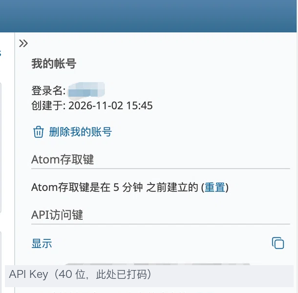

# dsh-superagent-redmine

[中文](README.md) | **English**

> Turn **Redmine** issues and comments into **dsh-superagent** tickets,
> let the agent work in an isolated worktree, and write results back as Redmine notes.
> Images in the description/comments can be **read by the model**.

[](LICENSE)


- **No fork of dsh-superagent**: a standalone npm package that registers a `redmine` Source through the cordis `orchestrator` service.
- **Images work**: Redmine attachments are downloaded and passed as model-visible attachments during Eval (something the GitHub channel cannot do).
- **Least privilege**: a dedicated account only needs “View issues + Add notes”; the plugin only writes `notes`—never status, assignee, or custom fields.
- **No loss, no duplicates**: reverse-order paging + overlap window + stable-id dedupe + hidden marker idempotency.

> Status: `0.1.0`, experimental. Verified end-to-end on **Redmine 6.1** (Docker, non-admin agent account).
> **Redmine 2.3.x** (intranet / self-hosted) is supported by design—run a read-only probe with your instance’s API key to confirm.

## What problem it solves

1. The GitHub channel cannot see screenshots inside issues; Feishu has images, but your team’s work lives in Redmine.
2. Migrating the team to GitHub is unrealistic; the agent should take tickets *in* Redmine and reply *in* Redmine.
3. dsh-superagent is a research prototype—forking it means missing upstream fixes—so this ships as a **standalone plugin**.

## How it works

```
Redmine project (issues + journals + attachments)
        │ poll GET /issues.json?project_id=…&status_id=*&sort=updated_on:desc,id:desc
        │ (no server-side time filter: Redmine 2.3 returns 422)
        ▼
dsh-superagent-redmine (this plugin)
        │ ① issue / journal → Trigger (Thread = redmine:<issueId>)
        │ ② auth: allow-list of numeric user ids + admission table
        │ ③ images: download attachments → model-visible attachments
        ▼
ctx.orchestrator.sources.register(redmineKind)
        ▼
dsh-superagent: Eval → Ticket → isolated worktree
        ▼
write-back PUT /issues/:id.json {"issue":{"notes":…}}   ← Channel (hidden marker)
```

## Requirements

| Dependency | Requirement |
|---|---|
| DSH | `dsh --version` matches `engines.dsh` (`^0.2.1-rc.3`) |
| dsh-superagent | Installed in the profile with **its own setup finished** (GitHub repo + agent CLI). Otherwise every Source stays `paused` |
| Node.js | ≥ 22.19 or ≥ 24 (built-in `fetch`) |
| Redmine | 2.3+ (2.3 / 6.x covered; 2.6–3.3 private notes have a known limit—see Compatibility) |
| Redmine account | **Dedicated** API account: “View issues + Add notes” on the target project |

> One plugin instance = one Redmine project (the host `SourceRegistry` uses the kind id as the instance id).
> Tickets still run in the GitHub repository configured for dsh-superagent; this plugin only swaps the ingress and write-back channel.

## Install

### 1. Build

```sh
cd <plugin-repo-root>           # whatever the clone directory is named
pnpm install
pnpm check                      # typecheck + tests + build → lib/index.js and lib/index.d.ts
```

### 2. Add to the superagent profile

> Prefer a local build for now (not published to npm; the maintainer publishing checklist lives in the monorepo at `docs/dsh-superagent-redmine/PUBLISHING.en.md` and is not shipped with this package).

```sh
dsh plugin --profile superagent add "link:$PWD"
```

Then edit `~/.dsh/profiles/superagent/cordis.patch.yml` and append (profile patches stack; new plugins must use `insert`):

```yaml
- insert:
    - id: dsh-superagent-redmine
      name: dsh-superagent-redmine
```

### 3. Provide the API key

```sh
export REDMINE_API_KEY=<your-key>
```

The key must be visible to **the process that starts DSH**: tmux inherits the shell that started it; launchd/Finder-started processes do not inherit terminal `export`s—put the variable in a launchd plist or startup script. **Never store the key in the settings database or the repository.**

### 4. Restart and confirm

```sh
cd ~/src/dsh-superagent && scripts/dsh-superagent restart
scripts/dsh-superagent status; echo "status=$?"     # expect 0
```

- Settings → Sources shows a **Redmine** card;
- Opening the card (empty config) does not error;
- The execution environment lists `DSH_SUPERAGENT_REDMINE_URL` / `_PROJECT` / `_ISSUE`.

## Getting a Redmine API key



1. Sign in with the **dedicated** account and open **My account** (top right);
2. Find **API access key**, click **Show** (or **Reset** to create one); copy the 40-character string.
   If the key ever leaked, **Reset** in the same place—the old key stops working immediately;
3. Export it into the DSH process environment:

   ```sh
   export REDMINE_API_KEY=<paste-here>
   ```

4. **Permissions**: at least “View issues” and “Add notes” on the target project; prefer only those two.
5. **Older versions (2.3, etc.)**: if the API returns 404/401, ask an admin to enable REST API under **Administration → Settings → API**.
   “My account” layout differs, but it is still **API access key → Show/Reset**.
6. **Verify**:

   ```sh
   curl -sS -H "X-Redmine-API-Key: $REDMINE_API_KEY" \
     -H 'Accept: application/json' \
     "$REDMINE_URL/users/current.json" | jq '.user | {id, login}'
   ```

   Your account means success; 401 means a bad key; 404 usually means REST API is off or the URL is wrong.

> The screenshot is for location only; the key is redacted. **Never paste a real key into issues, logs, or screenshots.**

## Configuration

Settings → Sources → Redmine:

| Field | Default | Meaning |
|---|---|---|
| `baseUrl` | empty | Redmine root (`http://` or `https://`). Empty = not configured; polling reports `paused` |
| `projectId` | empty | Project identifier (preferred) or numeric id; first poll resolves to a numeric id and caches it (list filters only accept numbers) |
| `apiKeyEnv` | `REDMINE_API_KEY` | **Name** of the env var holding the key; the secret is not stored |
| `mention` | `@dsh` | Mention keyword; escaped before the regex; whole-word, case-insensitive |
| `pollSeconds` | `60` | Poll interval (30–3600) |
| `failuresBeforeError` | `3` | Consecutive failures before health becomes `error` |
| `overlapSeconds` | `120` | Overlap window; each round re-reads this long before the cursor; duplicates dropped by stable id |
| `writeBack` | `notes` | `notes` = reply as comments / `off` = read-only (zero write requests) |
| `timezone` | empty | IANA zone for Redmine timestamps **without** a zone (e.g. `Asia/Shanghai`); empty = process zone |
| `observeIssues` | off | Unmentioned new issues also enter the receive scope (Policy admission table decides) |
| `observeNotes` | off | Unmentioned comments also enter the receive scope |
| `assigned` | on | Assignment to the agent account counts as an explicit request |

### Policy: who may assign work

Policy entries use **numeric user ids**—Redmine serializes issue/journal users as `{ id, name }` only, with no `login`:

- Open the user’s profile; the number in `…/users/<id>` is the id;
- With an empty list, only the “outside list but mentioned” cell is editable (default `ignore`)—nothing is accepted;
- Names are display-only and may be blank;
- Admission table has two rows: `New issue` / `Comment`. Unmentioned messages reach the gate only when the matching `observe*` switch is on.

## Usage

1. Create an issue or comment in Redmine that contains `@dsh` (or assign the issue to the agent account);
2. Within ≤ 2 poll intervals the plugin emits a Trigger → Eval decides → Ticket is created;
3. The agent runs in the repository/worktree configured for dsh-superagent;
4. On completion a note is written back to the same issue; retries do not duplicate notes.

**Health and facts**: Overview’s `redmine` entry shows poll status, consecutive failures, and counts this round; the card shows `Connected as <login>` and the project name after the first successful poll.

**Dropped requests**: outside the allow-list, unmentioned, private notes, etc. do not create tickets; reasons appear on the Source page (same pattern as the GitHub channel).

**Read-only soak**: set `writeBack` to `off` first, confirm Triggers and images, then enable write-back.

## Image recognition

Images in descriptions and comments are extracted, downloaded, and attached as **model-visible** inputs during **Eval**.

| Syntax | Parsed as | Notes |
|---|---|---|
| `` | `att:456` | Also `thumbnail` / `thumbnails` and sized thumbnail paths |
| `!shot.png!` / `!>shot.png!` / `!{width:300px}shot.png!` | `file:shot.png` | Match by attachment filename on the issue; newest wins on collision |
| `attachment:shot.png` | `file:shot.png` | Same; supports non-ASCII names and trailing punctuation |

- **PNG / JPEG / WebP / GIF** only; SVG, BMP, PDF are not offered as images;
- The model must support image input, or Eval **errors clearly** (`模型不支持图片输入`) instead of silently ignoring;
- Deployment attachment byte limits apply; oversize errors clearly;
- Only Redmine attachments—no arbitrary remote image URLs; the API account must be able to read the attachment;
- Text and images from `private_notes` journals **never** enter context.

> **Boundary**: images are visible to **Eval** (accept/reject and understand the request). The worker in an isolated worktree does not automatically receive image bytes. If the worker must “see” an image, Eval should describe it in the ticket/receipt, or an upstream extension is needed.

## Compatibility

| Capability | 2.3 | 2.6–3.3 | 3.4–5.x | 6.x |
|---|---|---|---|---|
| `/users/current.json`, project resolve | ✅ | ✅ | ✅ | ✅ |
| Reverse paging / `status_id=*` / `limit=100` | ✅ | ✅ | ✅ | ✅ |
| **Server `updated_on` timestamp filter** | ❌ 422 (unused) | unverified | ✅ | ✅ |
| `include=journals,attachments` | ✅ | ✅ | ✅ | ✅ |
| issue/journal user is `id+name` only | ✅ | ✅ | ✅ | ✅ |
| `journal.private_notes` | n/a | ⚠️ feature exists, API omits field | ✅ | ✅ |
| Attachment `/attachments/:id.json` + API key | ✅ | ✅ | ✅ | ✅ |
| `PUT /issues/:id.json` notes | ✅ | ✅ | ✅ | ✅ |

- **Private notes on 2.6–3.3**: Redmine has the feature but the API omits `private_notes`, so the client cannot detect them; upgrade to 3.4+ or agree not to treat private notes as requests.
- **Timestamps**: deployments may return `+08:00`, `Z`, `+0800`, or zoneless values. Zoneless values use the `timezone` setting; the cursor always stores UTC.
- The plugin only relies on fields common across versions (`id` / `name` / `notes` / `created_on` / `details` / `attachments`), not `status.is_closed` / `journal.updated_on`.

## Troubleshooting

| Symptom | What to do |
|---|---|
| Card stuck `paused` (“Waiting for the deployment check”) | Finish dsh-superagent’s own GitHub/agent CLI setup |
| `error`: `REDMINE_API_KEY is empty or unset` | Key not visible to the DSH process; see “Provide the API key” |
| `error`: `Redmine responded 401` | Invalid/reset key; regenerate and update the environment |
| `error`: project 404 | Wrong identifier, or the account cannot see the project |
| `ready` but 0 issues | Role may lack “View issues” (2.3 may not 403 on `project_id` queries) |
| Images unreadable | No permission to download, or format outside PNG/JPEG/WebP/GIF |
| Only old comments | First run does not backfill; new comments must appear after process start |
| `Invalid time zone` | `timezone` is not a valid IANA zone |
| Proxy strips `X-Redmine-API-Key` | After 401 the plugin falls back to `?key=` and caches it |

Fuller deploy/troubleshooting: [SETUP.en.md](SETUP.en.md). Before go-live, run the **read-only probe** (`scripts/probe-redmine.sh`) to confirm permissions, timestamp shapes, and attachments.

## Development

```sh
pnpm typecheck
pnpm test          # 112 cases: contract / unit / mock HTTP integration
pnpm build
pnpm check         # all three
```

Layout:

```
src/
├── index.ts                plugin entry: name / inject / apply; register kind and start polling
├── kind.ts                 createRedmine(): schema + fields + policy + scope + channel + threadContext + environment + facts
├── config.ts               zod config (every field has a default)
├── contract.ts             local structural types for the host contract + cordis Context augmentation
├── key.ts                  stable ids (sha256 truncated to 32 hex chars)
└── redmine/
    ├── client.ts           fetch wrapper: API key (header → ?key=), timeouts, error mapping, streamed download limits
    ├── time.ts             four timestamp shapes → UTC ISO
    ├── types.ts            zod schemas for API payloads
    ├── trigger.ts          issue/journal → Trigger; mention/assignment; image keys
    ├── poll.ts             first-poll checks, reverse paging, window cursor, health
    ├── channel.ts          write-back: writeBack gate, marker idempotency, notes only
    ├── read.ts             thread/root/parent context
    └── images.ts           attachments → model-visible images
scripts/probe-redmine.sh   read-only probe before go-live
assets/                    screenshots used by the README (API key redacted)
```

Against a real instance (do not commit secrets):

```sh
# local Docker: docker run -p 3000:3000 redmine:6.1
export REDMINE_URL=http://127.0.0.1:3000
export REDMINE_API_KEY=<test-account-key>
export REDMINE_PROJECT=<project-identifier>
./scripts/probe-redmine.sh
```

## Contributing

See [CONTRIBUTING.en.md](CONTRIBUTING.en.md). Before submitting: `pnpm check` passes, new behavior has tests, no keys committed.

## Security

See [SECURITY.en.md](SECURITY.en.md). Keys only from env; notes-only writes; `writeBack=off` means zero write requests; plain HTTP only on intranet/VPN.

## License and acknowledgements

[MIT](LICENSE).

- The plugin contract (`SourceKind` / `SourceContext`, etc.) follows dsh-superagent (MIT); this repo only declares structural types and does not import its runtime modules.
- Runtime dependency: [zod](https://zod.dev) (MIT).
- Design docs (requirements, design, API notes, test plan) stay in the monorepo at `docs/dsh-superagent-redmine/` and are not published with this package.
