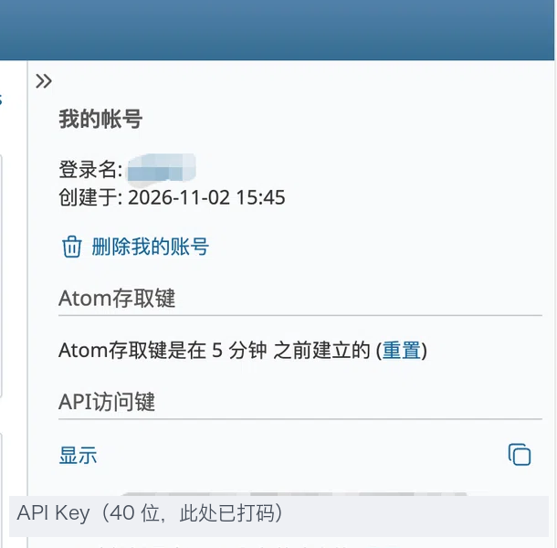

# dsh-superagent-redmine

**中文** | [English](README.en.md)

> 把 **Redmine** 的 issue 与评论变成 **dsh-superagent** 的工单（Ticket），
> 由 agent 在独立 worktree 里处理，结果以 Redmine 评论（notes）回写；正文/评论里的**图片可以被模型读取**。

[](LICENSE)


- **不修改、不 fork dsh-superagent**：独立 npm 包，通过 cordis 服务 `orchestrator` 注册一个 `redmine` Source。
- **图片可用**：Redmine 附件会下载并作为「模型可见附件」参与 Eval（GitHub 渠道做不到这一点）。
- **最小权限**：专用账号只需要「查看问题 + 添加评论」；插件只会写 `notes`，绝不改状态/指派人/自定义字段。
- **不丢不重**：倒序分页 + 重叠窗口 + 稳定 id 去重 + 隐藏 marker 幂等。

> 状态：`0.1.0`，实验阶段。已在 **Redmine 6.1**（Docker，非管理员 agent 账号）完成真实链路验证；
> **Redmine 2.3.x**（内网/自建实例）按兼容性设计实现，需用你的目标实例 API Key 跑一次只读探测确认。

## 它解决什么问题

1. GitHub 渠道看不到 issue 里的截图；飞书渠道有图片，但团队的问题在 Redmine。
2. 让团队迁到 GitHub 不现实；agent 应该到 Redmine 里接单、在 Redmine 里回帖。
3. dsh-superagent 是 research prototype，fork 后无法跟进上游修复——所以做成**独立插件**。

## 工作原理

```
Redmine 项目（issues + journals + attachments）
        │ 轮询 GET /issues.json?project_id=…&status_id=*&sort=updated_on:desc,id:desc
        │（不发送服务端时间过滤：Redmine 2.3 会 422）
        ▼
dsh-superagent-redmine（本插件）
        │ ① issue / journal → Trigger（Thread = redmine:<issueId>）
        │ ② 授权：allowed 数字用户 id 名单 + 准入表
        │ ③ 图片：附件下载 → 模型可见附件
        ▼
ctx.orchestrator.sources.register(redmineKind)
        ▼
dsh-superagent：Eval → Ticket → 独立 worktree 干活
        ▼
回写 PUT /issues/:id.json {"issue":{"notes":…}}   ← Channel（带隐藏 marker）
```

## 环境要求

| 依赖 | 要求 |
|---|---|
| DSH | `dsh --version` 与 `engines.dsh`（`^0.2.1-rc.3`）匹配 |
| dsh-superagent | 已装进 profile，且**它自己的 setup 必须先完成**（当前要求 GitHub 仓库 + agent CLI）。否则所有 Source 都是 `paused` |
| Node.js | ≥ 22.19 或 ≥ 24（插件用内置 `fetch`） |
| Redmine | 2.3 及以上（2.3 / 6.x 已覆盖；2.6–3.3 的私有备注有已知限制，见「兼容性」） |
| Redmine 账号 | **专用** API 账号：目标项目内「查看问题 + 添加评论」 |

> 一个插件实例 = 一个 Redmine 项目（宿主 `SourceRegistry` 以 kind id 作为实例 id）。
> 工单仍然在 dsh-superagent 配置的 GitHub 仓库里执行，本插件只换「入口 + 回写渠道」。

## 安装

### 1. 构建

```sh
cd <插件仓库目录>           # 克隆后的目录（本地叫什么都可以）；已在该目录时跳过
pnpm install
pnpm check                  # typecheck + 测试 + 构建；产出 lib/index.js 与 lib/index.d.ts
```

### 2. 装进 superagent profile

> 目前推荐从本地构建安装（未发布到 npm；维护者发布清单见 monorepo 本地 `docs/dsh-superagent-redmine/PUBLISHING.md`，不随包公开）。

```sh
dsh plugin --profile superagent add "link:$PWD"
```

然后编辑 `~/.dsh/profiles/superagent/cordis.patch.yml`，在末尾追加（profile patch 是叠加，新增插件必须用 `insert`）：

```yaml
- insert:
    - id: dsh-superagent-redmine
      name: dsh-superagent-redmine
```

### 3. 提供 API Key

```sh
export REDMINE_API_KEY=<你的 Key>
```

Key 必须对 **DSH 启动的那个进程**可见：tmux 会让新会话继承启动 tmux 的 shell 环境；launchd/Finder
启动的进程不继承终端里的 `export`，需要写进 launchd plist 或启动脚本。**不要把 Key 写进设置数据库或仓库。**

### 4. 重启并确认

```sh
cd ~/src/dsh-superagent && scripts/dsh-superagent restart
scripts/dsh-superagent status; echo "status=$?"     # 期望 0
```

- Settings → Sources 出现 **Redmine** 卡片；
- 点开卡片（默认空配置）不报错；
- 「执行环境」里出现 `DSH_SUPERAGENT_REDMINE_URL` / `_PROJECT` / `_ISSUE`。

## 获取 Redmine API Key



1. 用**专用账号**登录 Redmine，点右上角 **「我的账号」**；
2. 右侧找到 **「API 访问键」**，点 **「显示」**（没有就点「重置」生成）；点右侧复制图标复制这串 40 位字符。
   如果 Key 曾经泄露，在同一位置点 **「重置」**，旧 Key 会立即失效；
3. 把它放到 DSH 启动环境里：

   ```sh
   export REDMINE_API_KEY=<粘贴到这里>
   ```

4. **确认账号权限**：在目标项目里至少拥有「查看问题」与「添加评论」；建议只给这两个权限。
5. **旧版本（2.3 等）**：如果 API 返回 404/401，请管理员在 **管理 → 配置 → API** 勾选「启用 REST API」；
   「我的账号」页面布局与新版不同，但同样是 **API 访问键 → 显示/重置**。
6. **验证 Key 可用**：

   ```sh
   curl -sS -H "X-Redmine-API-Key: $REDMINE_API_KEY" \
     -H 'Accept: application/json' \
     "$REDMINE_URL/users/current.json" | jq '.user | {id, login}'
   ```

   返回你的账号即成功；401 表示 Key 无效，404 多为 REST API 未启用或地址不对。

> 截图只用于说明位置，Key 已打码。**不要把真实 Key 贴到 issue、日志或截图里。**

## 配置

Settings → Sources → Redmine：

| 字段 | 默认 | 说明 |
|---|---|---|
| `baseUrl` | 空 | Redmine 根地址（`http://` 或 `https://`）。空 = 未配置，轮询写 `paused` 健康 |
| `projectId` | 空 | 项目 identifier（推荐）或数字 id；首轮解析成数字 id 并缓存（Redmine 的列表过滤只接受数字） |
| `apiKeyEnv` | `REDMINE_API_KEY` | 存放 API Key 的**环境变量名**；密钥不落库 |
| `mention` | `@dsh` | 点名关键字；构造正则前转义，整词匹配、不区分大小写 |
| `pollSeconds` | `60` | 轮询间隔（30–3600） |
| `failuresBeforeError` | `3` | 连续失败几次后把健康标成 `error` |
| `overlapSeconds` | `120` | 重叠窗口；每轮重读游标前这段时间，重复项按稳定 id 去重 |
| `writeBack` | `notes` | `notes` 回评论 / `off` 只读（零写请求） |
| `timezone` | 空 | 解析**不带时区**的 Redmine 时间用的 IANA 时区（如 `Asia/Shanghai`）；空 = 进程时区 |
| `observeIssues` | 关 | 未点名的新 issue 也进入接收范围（交给策略准入表） |
| `observeNotes` | 关 | 未点名的评论也进入接收范围（交给策略准入表） |
| `assigned` | 开 | 指派给 agent 账号也算明确请求 |

### Policy：谁可以派活

Policy 里填 **数字用户 id**——Redmine 的 issue/journal 只序列化 `{ id, name }`，没有 `login`：

- 打开 Redmine 个人资料页，地址 `…/users/<id>` 里的数字就是 id；
- 名单为空时，只有「名单外但点名」一格可编辑（默认 `ignore`），不会接任何单；
- 名字只用于显示，可留空；
- 准入表两行：`新 Issue` / `评论`。未点名的消息只有在对应 `observe*` 开关打开时才会进入门禁。

## 使用

1. 在 Redmine 里新建 issue 或发评论，正文包含 `@dsh`（或把 issue 指派给 agent 账号）；
2. 插件在 ≤ 2 个轮询周期内生成 Trigger → Eval 决定是否接单 → 建 Ticket；
3. agent 在 dsh-superagent 配置的仓库/worktree 里执行；
4. 完成后回写一条评论到原 issue；重试不会产生重复评论。

**健康与事实**：Overview 的 `redmine` 条目显示轮询状态、连续失败次数与本轮读到的数量；卡片上显示
`Connected as <login>` 与项目名（首次轮询成功之后）。

**被丢弃的请求**：白名单外、未点名、私有备注等不会建单，原因可在 Source 页查看（与 GitHub 渠道一致）。

**只读观察**：把 `writeBack` 设为 `off` 先跑一段时间，确认 Trigger 与图片都正常，再打开回写。

## 图片识别

正文和评论里的图片会被抽取、下载，并在 **Eval 阶段**作为模型可见附件参与判断。

| 写法 | 解析为 | 说明 |
|---|---|---|
| `` | `att:456` | 也支持 `thumbnail` / `thumbnails` 与缩略图尺寸路径 |
| `!shot.png!` / `!>shot.png!` / `!{width:300px}shot.png!` | `file:shot.png` | 按 issue 附件名匹配，同名取最新 |
| `attachment:shot.png` | `file:shot.png` | 同上，支持中文文件名与后接标点 |

- 支持 **PNG / JPEG / WebP / GIF**；SVG、BMP、PDF 不会被当作图片提供；
- 模型必须支持图片输入，否则会**明确报错**（`模型不支持图片输入`），不会静默忽略；
- 受部署的附件字节上限约束，超限明确报错；
- 只认 Redmine 附件，不下载任意外链图片；API 账号必须能读取该附件；
- `private_notes` 的评论，其文字和图片**不会**进入上下文。

> **边界**：图片对 **Eval** 可见（决定是否接单、理解需求）；执行工单的 worker 在独立 worktree 里，
> 不会自动获得图片字节。需要 worker「看见」图时，应由 Eval 在工单描述/回执里写出图片内容，或由上游扩展。

## 兼容性

| 能力 | 2.3 | 2.6–3.3 | 3.4–5.x | 6.x |
|---|---|---|---|---|
| `/users/current.json`、项目解析 | ✅ | ✅ | ✅ | ✅ |
| 倒序分页 / `status_id=*` / `limit=100` | ✅ | ✅ | ✅ | ✅ |
| **服务端 `updated_on` 时间戳过滤** | ❌ 422（插件不使用） | 未验证 | ✅ | ✅ |
| `include=journals,attachments` | ✅ | ✅ | ✅ | ✅ |
| issue/journal 用户只有 `id+name` | ✅ | ✅ | ✅ | ✅ |
| `journal.private_notes` | 无此功能 | ⚠️ 有功能但 API 不返回 | ✅ | ✅ |
| 附件 `/attachments/:id.json` + API Key | ✅ | ✅ | ✅ | ✅ |
| `PUT /issues/:id.json` 写 notes | ✅ | ✅ | ✅ | ✅ |

- **2.6–3.3 的私有备注**：Redmine 有该功能，但 API 不返回 `private_notes`，客户端无法识别；
  建议升级到 3.4+，或约定不把私有备注当请求。
- **时间格式**：不同版本/部署会返回带 `+08:00`、`Z`、`+0800` 或不带时区的时间。不带时区的时间按
  `timezone` 配置解析，游标统一存 UTC。
- 插件只使用各版本一致的字段（`id` / `name` / `notes` / `created_on` / `details` / `attachments`），
  不依赖 `status.is_closed` / `journal.updated_on`。

## 排错

| 现象 | 处理 |
|---|---|
| 卡片一直 `paused`（"Waiting for the deployment check"） | dsh-superagent 自身 setup 未完成；先完成它的 GitHub/agent CLI setup |
| `error`：`REDMINE_API_KEY is empty or unset` | Key 对 DSH 进程不可见；见「提供 API Key」 |
| `error`：`Redmine responded 401` | Key 无效/已重置；重新生成并更新环境 |
| `error`：项目 404 | identifier 写错，或账号对该项目不可见 |
| `ready` 但 0 条 issue | 账号角色可能缺「查看问题」权限（2.3 对带 `project_id` 的请求不会返回 403） |
| 图片读不出来 | 账号无权下载该附件，或格式不在 PNG/JPEG/WebP/GIF 内；插件会如实报「图片不可读」 |
| 只看到旧评论 | 首次运行不回填历史；新评论需在 `启动时刻` 之后 |
| `Invalid time zone` | `timezone` 填了不存在的 IANA 时区 |
| 反向代理剥掉 `X-Redmine-API-Key` | 插件在 401 后自动改用 `?key=` 并缓存 |

更完整的部署与排错见 [SETUP.md](SETUP.md)；上线前建议先跑其中的**只读探测**（`scripts/probe-redmine.sh`），
确认账号权限、时间格式与附件可用性。

## 开发

```sh
pnpm typecheck
pnpm test          # 112 个用例：契约 / 单元 / mock HTTP 集成
pnpm build
pnpm check         # 三者合一
```

目录：

```
src/
├── index.ts                插件入口：name / inject / apply；注册 kind 并启动轮询
├── kind.ts                 createRedmine()：schema + fields + policy + scope + channel + threadContext + environment + facts
├── config.ts               zod 配置（每个字段都有默认值）
├── contract.ts             宿主契约的本地结构声明 + cordis Context 增强
├── key.ts                  稳定 id（sha256 截 32 位）
└── redmine/
    ├── client.ts           fetch 封装：API Key（header → ?key=）、超时、错误映射、流式下载限额
    ├── time.ts             四种时间写法统一成 UTC ISO
    ├── types.ts            API 响应的 zod schema
    ├── trigger.ts          issue/journal → Trigger；mention/指派；图片 key
    ├── poll.ts             首轮校验、倒序分页、窗口游标、健康上报
    ├── channel.ts          回写：writeBack 门禁、marker 幂等、只写 notes
    ├── read.ts             thread/root/parent 上下文
    └── images.ts           附件 → 模型可见图片
scripts/probe-redmine.sh   上线前只读探测
assets/                    README 用截图（API Key 已打码）
```

针对真实实例的联调（不提交到仓库）：

```sh
# 本机 Docker：docker run -p 3000:3000 redmine:6.1
export REDMINE_URL=http://127.0.0.1:3000
export REDMINE_API_KEY=<测试账号 Key>
export REDMINE_PROJECT=<项目 identifier>
./scripts/probe-redmine.sh
```

## 贡献

见 [CONTRIBUTING.md](CONTRIBUTING.md)。提交前请确认 `pnpm check` 通过、新增行为带测试、没有提交任何 Key。

## 安全

见 [SECURITY.md](SECURITY.md)。核心约定：Key 只从环境变量读取；只写 notes；`writeBack=off` 零写请求；
HTTP 只用于内网/VPN。

## 许可与致谢

本项目使用 [MIT](LICENSE)。

- 插件契约（`SourceKind` / `SourceContext` 等）参考 dsh-superagent（MIT），本项目只做结构声明，
  不 import 其运行时模块。
- 运行时依赖 [zod](https://zod.dev)（MIT）。
- 需求/方案/测试计划等设计文档仅保留在 monorepo 本地 `docs/dsh-superagent-redmine/`，不随本包发布。
